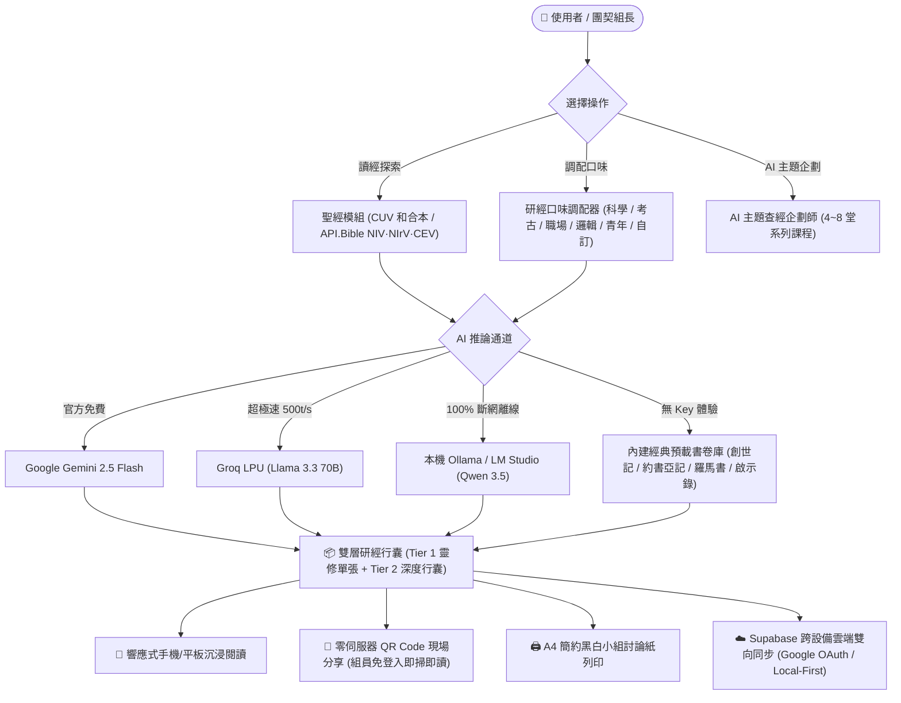

# 🎒 Bible Backpack (聖經行囊)

> **行動基督徒的深度研經與小組行囊 · 讓讀經變得立體、有趣且富有生命力**  
> *A Modern, Lightweight, Mobile-First Christian Devotional & Group Study Companion*

[](https://opensource.org/licenses/MIT)
[]()
[-3ECF8E.svg?logo=supabase)]()
[]()
[](https://buymeacoffee.com/akworkshop)

---

## 📖 什麼是 Bible Backpack？

**Bible Backpack（聖經行囊）** 是一套專為**個人靈修、家庭祭壇、團契小組長以及大專/青年團契**量身設計的現代化研經工具。

傳統的靈修工具往往面臨兩個極端：要麼過於學術生硬令人望而卻步，要麼過於片段空泛缺乏深入探索。Bible Backpack 結合了**當代正統基督教神學考證**與**現代 AI 視角調配技術**，將每一章聖經轉化為生動立體、充滿時代共鳴的「雙層研經行囊」，讓每一次讀經都不再是枯燥的例行公事，而是一場令人期待的屬靈探險！

---

## ✨ 核心特色與亮點

### 1. 雙層研經行囊設計 (Dual-Tier Architecture)
- **📄 Tier 1 · 靈修單張（組員版 / 個人版）**：
  - **核心金句與神聖焦點**：精練萃取全章的核心福音信息與救贖真理。
  - **歷史與文化時空走廊**：還原寫作歷史背景、作者處境與地理脈絡。
  - **生活應用與默想指引**：貼近現代人處境的落地操練，拒絕空泛大道理。
  - **小組破冰與敞開討論題**：設計有溫度、能引發深度交心的互動問題。
- **📚 Tier 2 · 深度行囊（小組長 / 深度研經版）**：
  - **希伯來文 / 希臘文原文考據**：關鍵字原文字義深度剖析。
  - **新舊約神聖救贖歷史串珠**：貫穿全本聖經的救贖歷史網絡。
  - **考古發現與古代近東文獻**：讓古老歷史化為真實觸感的考據佐證。
  - **神學反思與防偽辨析**：嚴謹護教指引，辨析歷史偏差與當代世俗主義思潮。

### 2. 獨創「多維度研經口味」調配 (Study Lenses Mixer)
讀經不是千篇一律的填鴨！Bible Backpack 讓您可以根據自己的興趣或小組成員的背景，自由調配不同的觀察稜鏡：
- 🔬 **自然科學印證**：宇宙天體、微觀生物、物理規律中的神聖創造印記。
- 🏛️ **歷史與考古實證**：泥板銘文、地理路線、羅馬帝國政經背景還原。
- 💼 **職場與現代實踐**：高壓競爭、灰色地帶、職業召命中的基督徒見證。
- 📐 **數學與嚴密邏輯**：文學對仗架構（Chiasmus）、先知論證邏輯與結構美學。
- 🔥 **青年與熱血應用**：校園社交、身份認同、時代使命與青年生命抉擇。
- 🎨 **藝術與靈修默想**：歷史名畫、聖樂符號、古典修道祈禱默想節奏。
- ✍️ **自訂專屬口味**：可自由輸入任意關鍵字（例如：「國小三年級主日學」、「軟體工程師」、「新手媽媽」），AI 將量身調配合適的比喻與切入點。

### 3. 嚴謹的正統歷史神學防護 (Orthodox Theology Guardrail)
- 所有內建演算法與 Prompt 提示工程嚴格扎根於**歷史主流大公信仰**（使徒信經、尼西亞信經、三一論、基督十字架代贖與因信稱義）。
- **堅決杜絕**強解經文、成功神學、靈恩偏差或異端私意解說，維持敬虔、尊重原文、具牧養關懷且富教育意義的語言風格。

### 4. 現場團契「即掃即讀」零伺服器分享 (Zero-Server Group Share)
- 聚會現場組長調配好材料後，點擊「分享」，即可在螢幕上產生專屬 **QR Code**。
- 組員只需用手機相機掃描，**無需註冊帳號、無需填寫 API Key、無需下載 App**，1 秒鐘直接載入整份查經單張！
- 亦支援 WhatsApp、LINE、AirDrop 一鍵直傳小組群組。

### 5. Local-First 極速離線 + Supabase 跨設備雲端同步
- **平時完全以手機/電腦 LocalStorage 運作**：0 毫秒極速載入，無網路的營會或退修會照常暢讀。
- **一鍵登入跨設備備份**：整合 Supabase 官方身分認證（Google 一鍵登入、Email 魔法連結），跨手機、電腦自動雙向同步您的個人 API Key、設定偏好與收藏背包，**100% 永久零主機費用負擔**。

### 6. 一鍵極簡 A4 印刷友善 (Print-Ready Sheets)
- 內建專屬 `@media print` 樣式表。點擊「列印單張」，系統自動隱藏所有網頁選單與按鈕，輸出黑白高對比度、自動分頁優化、排版優雅的 A4 小組查經講義。

---

## 🏗️ 系統運作架構圖



---

## 🚀 快速上手教學 (User Tutorial)

### 步驟 1：選擇經卷與譯本
- 在頂部中央的書卷選單點選想研讀的聖經書卷與章節（支援舊約 39 卷、新約 27 卷全本），可使用 `◀` 與 `▶` 快捷按鈕快速翻章。
- 支援**和合本 (CUV)**，若填入免費 API.Bible Key 亦可一鍵切換**英文現代譯本（NIV、NIrV 兒少易讀本、CEV 當代英文版）**。

### 步驟 2：設定您的「研經口味」
- 點擊頂部 **「🎨 研經口味」**，開啟雙分頁設定面板。
- 切換至 **「研經口味與風格」** 分頁，勾選符合您或小組背景的視角（例如同時勾選「自然科學印證」與「職場與現代實踐」）。
- 亦可在自訂欄位輸入特殊情境（如：「高三聯考壓力」、「醫療護理人員」）。
- 點擊「保存設置」，AI 將立即依此為您調配最具共鳴的經文反思！

### 步驟 3：體驗雙層研經行囊
- **靈修單張**：適合晨更靈修、組員聚會研討，包含核心信息、歷史背景、生活實踐與破冰題目。
- **深度行囊**：適合組長帶領或個人進階深造，深入原文考據、救贖史脈絡與古代文物背景。

### 步驟 4：使用「AI 主題查經企劃師」
- 點擊底部導航的 **「🎯 主題企劃」**。
- 輸入想帶領的主題（如：「走出焦慮與重尋安息」、「約瑟的職場風暴與信靠」），選擇堂數（4~8 堂）與對象（如：青年團契、職場上班族、弟兄小組）。
- AI 神學企劃師將自動跨越新舊約經文，企劃出整套每堂具備主題、指定經文、破冰問題與落實行動的完整系列教案，並支援一鍵列印整套課程大綱！

### 步驟 5：小組現場一鍵分享
- 點擊頂部 **「🔗 分享」** 按鈕，選擇要分享「靈修單張」、「深度行囊」或「完整雙層」。
- 螢幕立即呈現大尺寸 QR Code，聚會投影或讓組員拿出手機相機掃描，無需輸入任何帳號密碼，整套材料直接躍然於組員手機上！

---

## ⚙️ AI 免費 API 金鑰設定教學 (API Setup Guide)

Bible Backpack 堅持不向使用者收取任何費用，系統支援多種國際頂級且**提供永久免費額度**的 AI 通道，請依喜好選擇其中一種填入：

```
點擊網頁右上角「⚙️ 設置」按鈕 ➔ 在「AI 通道與系統」分頁輸入對應的 API Key ➔ 點擊保存即可！
```

### 推薦通道 A：⚡ Groq API（強烈推薦 · 超極速 500 tokens/秒）
- **優點**：速度極快（全篇單張 1~2 秒秒出！），每天享有高達 14,400 次免費請求，**完全不會遇到塞車或限流**。
- **取得方式**：
  1. 前往 [Groq Console](https://console.groq.com/keys)。
  2. 使用 Google 或 GitHub 帳號免費登入（免綁信用卡）。
  3. 點擊 **「Create API Key」**，複製以 `gsk_` 開頭的金鑰。
  4. 回到 Bible Backpack 設置面板，AI 通道勾選 **「Groq」** 並貼上金鑰。

### 推薦通道 B：🌟 Google Gemini API（官方免費 · 多模型容錯）
- **優點**：Google 官方旗艦大模型，神學考證嚴謹。系統內建 **5 款備用模型自動切換**（`gemini-2.5-flash`、`gemini-2.0-flash` 等），單一模型繁忙時自動遞補。
- **取得方式**：
  1. 前往 [Google AI Studio](https://aistudio.google.com/app/apikey)。
  2. 登入 Google 帳號，點擊 **「Get API key」➔「Create API key」**。
  3. 複製以 `AIzaSy` 開頭的金鑰。
  4. 回到 Bible Backpack 設置面板，AI 通道勾選 **「Google Gemini」** 並貼上金鑰。

### 推薦通道 C：💻 本地離線 AI（Ollama / LM Studio · 100% 隱私零外洩）
- **優點**：完全斷網運作，所有研經運算在您自己的電腦本機晶片執行，0 雲端依賴。
- **使用方式**：
  1. 電腦安裝 [Ollama](https://ollama.com)。
  2. 終端機執行：`ollama run qwen3.5:9b`（亦支援 `llama3.2`、`gemma2`）。
  3. 啟動服務時允許跨域：`$env:OLLAMA_ORIGINS="*" ; ollama serve`。
  4. 回到 Bible Backpack 設置面板，AI 通道勾選 **「本地離線 AI」**，端點填入 `http://localhost:11434/v1`，點擊「測試連線」即可自動載入已安裝模型！

### 方案 D：📖 英文經文授權 API.Bible Key（可選）
- 如需存取 NIV、NIrV、CEV 等當代英文譯本，可至 [API.Bible 官網](https://scripture.api.bible/signup) 免費註冊申請 API Key 填入設置，讀取過的章節會自動離線快取於瀏覽器。

---

## ❓ 常見問題解答 (FAQ)

<details>
<summary><strong>Q1: Bible Backpack 真的完全免費嗎？將來會不會突然收費？</strong></summary>

**保證 100% 永久免費。**  
本專案為基督徒個人事工開發，前端託管於免費靜態平台（Vercel / Netlify / GitHub Pages），資料庫使用 Supabase 免費方案，AI 推論採用各大官方提供的免費開發者 API 額度。整體架構沒有任何主機營運成本包袱，絕不設置付費牆。
</details>

<details>
<summary><strong>Q2: 小組聚會時，組員掃描 QR Code 需要註冊帳號或付費買 API Key 嗎？</strong></summary>

**完全不需要！**  
這正是 Bible Backpack 最便利之處。組長調配好的研經內容會經由輕量演算法高倍壓縮至專屬連結或 QR Code 中。組員用手機相機掃碼後，直接在瀏覽器呈現完整精美排版，不需要登入、不需要註冊、不需要填寫任何 API Key！
</details>

<details>
<summary><strong>Q3: 為什麼點擊 Google 登入時會跳出授權確認畫面？</strong></summary>

Bible Backpack 採用開源知名的 **Supabase** 進行安全雲端同步。登入僅用於識別您的身分，以便在您的不同裝置間同步「個人收藏筆記、自訂主題課程與 API Key 設置」。我們絕不會讀取您的聯絡人、郵件或私人雲端檔案，亦絕無任何第三方廣告追蹤。
</details>

<details>
<summary><strong>Q4: AI 生成的神學內容足夠客觀正統嗎？會不會胡言亂語？</strong></summary>

系統內建嚴格的神學護欄（System Prompt Instructions），要求 AI 嚴守歷史正統基督信仰，遵循歷代教會共認的大公信經。所有經文考證均尊重原文文法與歷史處境，拒絕牽強附會。然而 AI 始終為**輔助工具**，不能替代聖靈的感動、聖經原文權威以及教會牧者的牧養教導。
</details>

<details>
<summary><strong>Q5: 沒有網路的時候可以使用嗎？</strong></summary>

**可以！**  
Bible Backpack 採用 Local-First（本地優先）架構。全本和合本經文、內建的 4 大示範書卷（創世記 1 章、約書亞記 1 章、羅馬書 8 章、啟示錄 21 章）以及您先前閱讀過或收藏的材料均保存在瀏覽器離線快取中，即使完全沒有網路也能流暢開啟閱讀。
</details>

---

## 🛠️ 本地開發與部署 (Development)

本專案採用最純粹乾淨的 **Vanilla HTML5 + Tailwind CSS (CDN) + 原生 JavaScript** 開發，零肥大框架依賴，無需 `npm install` 漫長建置等待：

```bash
# 1. 複製專案
git clone https://github.com/akworkshop/bible-backpack.git
cd bible-backpack

# 2. 啟動本機簡易伺服器 (以 Python 為例)
python -m http.server 8000

# 3. 打開瀏覽器
訪問 http://localhost:8000 即可進行開發與測試！
```

### 一鍵部署至 Vercel / Netlify
直接將本儲存庫 Import 至 [Vercel](https://vercel.com) 或 [Netlify](https://netlify.com)，設定維持預設（Static Site），20 秒即可完成全自動部署！

---

## ☕ 支持這項研經事工 (Support the Ministry)

**Bible Backpack** 是由獨立基督徒開發者出於對神話語的熱愛與服事心志所建立的開源項目。

我們堅持保持**純粹、零商業廣告、100% 永久免費**，期望能祝福全球各地的個人靈修者、大專青年團契與小組同工。

如果您認同這個事工的異象，或 Bible Backpack 曾在您的靈修默想、家庭小組或查經服事中祝福過您，**歡迎請作者喝杯咖啡，支持系統伺服器與持續維護開發！**

<div align="center">
  <br>
  <a href="https://buymeacoffee.com/akworkshop" target="_blank" rel="noopener noreferrer">
    
  </a>
  <br><br>
  <p><strong>願神透過祂的話語親自堅固您的生命與事奉！</strong></p>
  <p><em>「你的話是我腳前的燈，是我路上的光。」—— 詩篇 119:105</em></p>
</div>

---

<div align="center">
  <small>© 2026 Bible Backpack · Crafted with prayer and code by AK Workshop</small>
</div>
